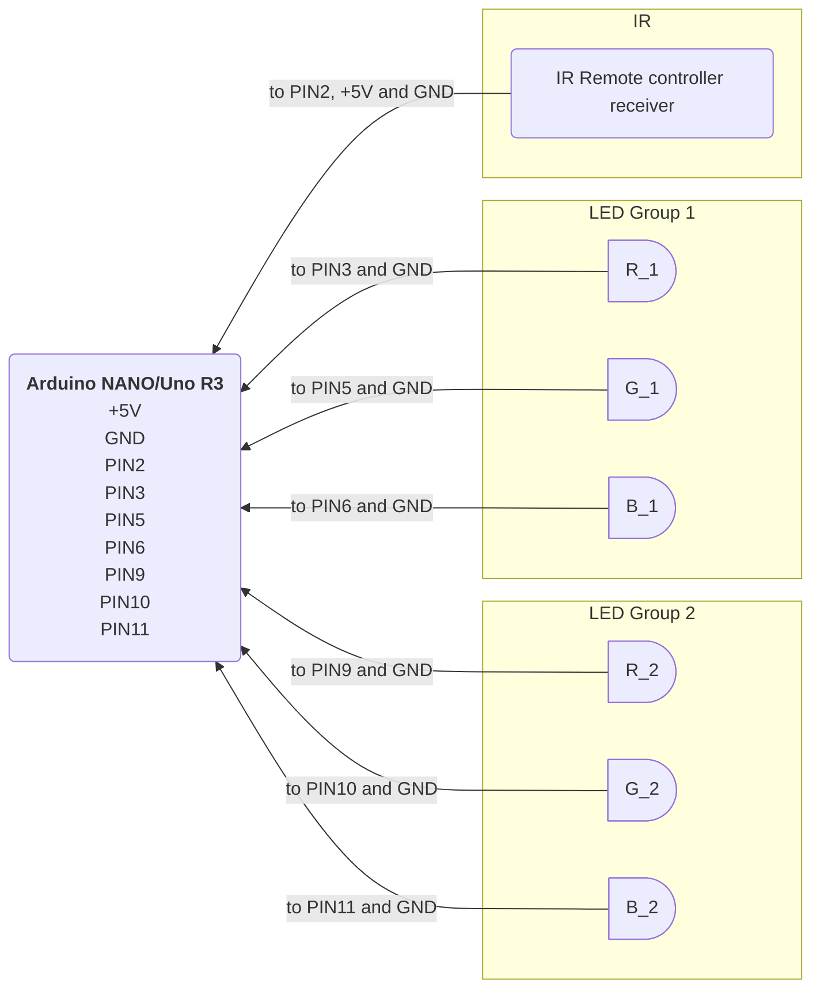

# nano-kontroller

### Simple 6 channel RGB LED controller for Arduino NANO / Uno R3

- Uses Arduino NANO or Uno R3 to drive RBG LEDs connected to PWM pins `3`, `5`, `6`, `9`, `10` and `11`.
- Has IR remote control receiver module listening on Digital pin `2`.
- Uses interrupt-based [TinyIRReceiver](https://github.com/Arduino-IRremote/Arduino-IRremote#tiny-nec-receiver-and-sender) library to free up all 6 PWM channels for driving LEDs.
- LED effect programs can be selected using remote controller.
- PWM channel layout is meant for driving 2 RGB LED groups, so one PWM channel per colour. See the diagram for wiring details.

**Warning: Arduino can only safely deliver max 20mA per PWM channel!**

If you need to drive a whole LED strip then you need an external MOSFET setup to handle passing the higher current required.

Currently this controller only supports the NEC IR protocol. The very simple NEC IR protocol is probably the most common one used for LED strips, so there's a good chance that you already own a compatible remote controller. The ubiquitous Chinese IR remote that shipped with any LED strip "should just work".

### Arduino NANO PIN layout

### References

- https://docs.arduino.cc/tutorials/nano-r4/external-interrupts/
- https://github.com/Arduino-IRremote/Arduino-IRremote
- https://github.com/Arduino-IRremote/Arduino-IRremote#tiny-nec-receiver-and-sender

### Author

- [Ukko-Pekka Keihäs](https://github.com/upkeihas)

